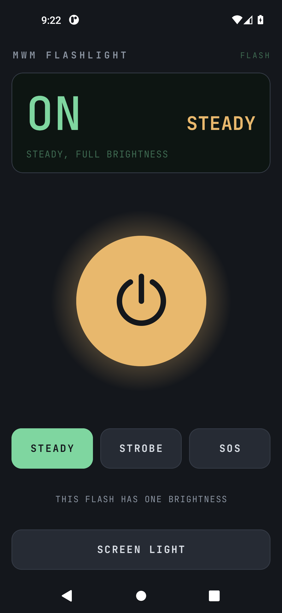

# MWM Flashlight

A plain flashlight for Android. One big button turns the phone's camera flash
on and off. That is the whole job, plus the few extras you reach for in the
dark.

*The main screen with the light on in steady mode: status display, power button, mode buttons and the screen light button.*

## 📲 Download

**[⬇ Latest APK](https://github.com/Matswm86/mwm-flashlight/releases/download/latest/mwm-flashlight-9f60fe9.apk)**
&nbsp;·&nbsp; [all builds](https://github.com/Matswm86/mwm-flashlight/releases)

Open the link on your phone, tap the file, and allow "install from this source"
when Android asks. Android 8.0 or newer (minSdk 26). The filename carries the
commit id on purpose, so your browser can never serve you a cached old build. If
the link 404s, a newer build has landed: grab the newest `mwm-flashlight-*.apk`
off the releases page.

Debug-signed. Reinstalling over a build with a different signature means
uninstalling the old one first.

## What it does

- **No ads, no account, no tracking, no permissions.** The app asks for
  nothing at all, not even the camera or the internet, so it has no way to
  phone anywhere.
- **One tap.** The power button is the biggest control on the screen and gives
  a short buzz when pressed.
- **Brightness control** on phones whose flash supports it (Android 13 or
  newer, depending on the phone). Other phones get full brightness.
- **Strobe** from 1 to 15 flashes a second.
- **SOS** in Morse code (`··· ––– ···`), repeating until you stop it.
- **Screen light:** the whole screen turns white at full brightness. Useful
  when you want soft light, or on a phone without a flash, where the power
  button opens it directly.
- A steady light stays on when you leave the app, just like the quick
  settings tile. Strobe and SOS stop when you leave, because they need the app
  on screen to drive them.

## How it works

Kotlin and Jetpack Compose, no third-party libraries beyond AndroidX and
kotlinx.coroutines. The flash is switched through Android's Camera2 torch calls,
which need no permission, and the app listens for torch changes so the display
follows a steady light that is switched elsewhere, for example from the quick
settings tile. Brightness uses the torch strength call added in Android 13.
Strobe and SOS are lists of timed on and off steps that a coroutine plays on the
main thread, which is why they stop when you leave the app. The last mode,
brightness and strobe speed are kept in the app's private preferences.

## Using it

| On screen | What it means |
|-----------|---------------|
| `ON` / `OFF` | Whether the light is on |
| STEADY / STROBE / SOS | The light mode; tap one to switch, even while the light is on |
| BRIGHTNESS slider | How bright the flash is; only shown when your phone supports it |
| SPEED slider | Strobe flashes per second |
| FLASH IN USE BY ANOTHER APP | The camera app (or another app) has the camera open; close it first |
| SCREEN LIGHT | Turns the whole screen white; tap anywhere or press back to close |

**Strobe warning.** Fast flashing light can trigger seizures in people with
photosensitive epilepsy. Do not point the strobe at people.

## What it deliberately does not do

- No widgets, themes, colour filters or settings screens.
- No network access of any kind.
- No permissions.

## Status

Version 0.1.0. Only debug-signed builds exist; there is no release-signed build.

## Building

There is no local build step. GitHub Actions builds the APK on every push to
`main`, runs the unit tests, then installs the APK on an emulator, presses the
power button, switches to SOS and back, and opens and closes the screen light.
The README screenshot comes from that emulator run.

The display font is JetBrains Mono (SIL Open Font License, see `licenses/`).

## License

MIT, see [LICENSE](LICENSE).
